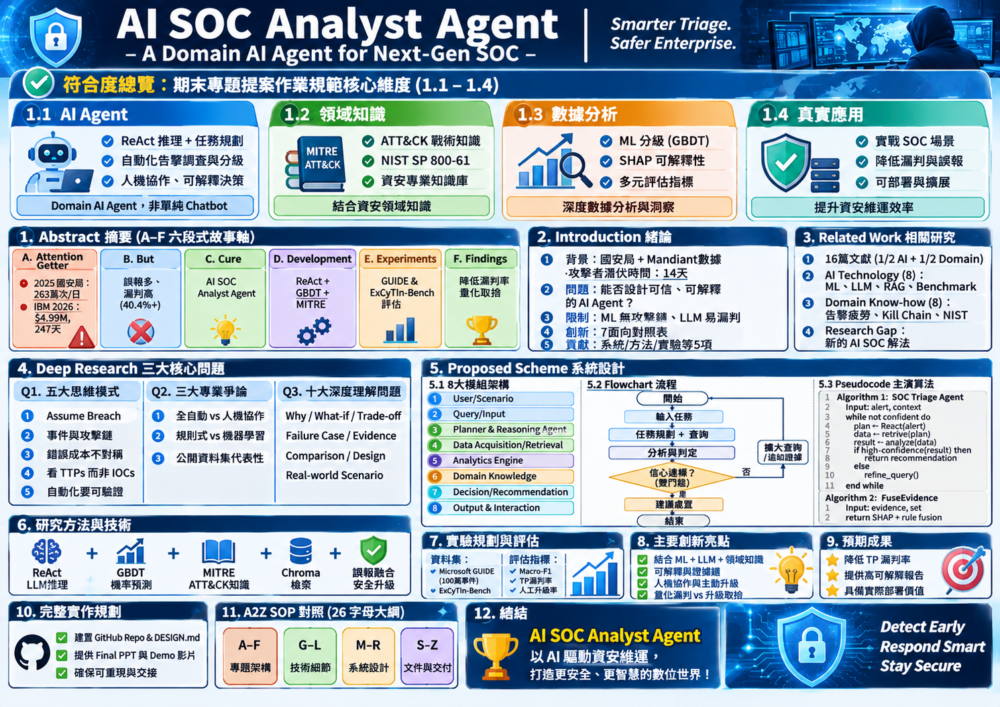

# AIOT-DIC4 — AI SOC Analyst Agent：IEEE ICEIB 2027 論文工作區

> **Knowing When to Escalate: An Evidence-Fusion SOC Triage Agent Integrating Gradient-Boosted Classification, MITRE ATT&CK Knowledge, and LLM Reasoning**
> *GBDT + SHAP Triage · MITRE ATT&CK RAG · ReAct LLM Planner · Evidence Fusion & Escalation*



本 repo 是投稿 **ICEIB 2027**（7th International Conference on Electronic Communications, Internet of Things and Big Data，2027 年 4 月 23–25 日，淡江大學）的論文工作區。論文依 **2020 A-Z SOP** 撰寫，每個章節由一個編號的 OpenSpec 變更管理；原始專題資料保存在 `AIOT-DIC3-ProjectRefactor/`。

---

## 📁 專案目錄結構

```text
AIOT-DIC4/
├── README.md                              # 專案總覽與導覽（本檔案）
├── AIOT-DIC3-ProjectRefactor/             # 原始專題（唯讀來源）：Proposal、DESIGN.md、規劃文件、系統實作規格
│   ├── README.md · DESIGN.md
│   ├── docs/ (project-core.md, proposal.md)
│   ├── myplan/ · data/
│   ├── src/soc_agent/                    # 系統實作（分析、知識庫、LLM、融合與升級）
│   ├── experiments/ (+ results/)          # 實驗程式與結果檔（論文數字的唯一來源）
│   └── openspec/changes/build-soc-triage-agent/   # 系統實作與實驗的規格
├── iceib-paper/                           # 論文
│   ├── main.tex                           # IEEEtran 論文原始檔（Overleaf 編譯）
│   ├── main.txt                           # main.tex 的逐位元組副本
│   └── check_a2z.py                       # A2Z / 章節 / 引用 / 同步 / 投稿阻礙檢查
├── my_ref/                                # 寫作依據
│   ├── README.md                          # 領域事實摘要：論文數字與主張的唯一來源
│   ├── A2Z outline example.pdf / .md      # 2020 A-Z SOP
│   └── AI_SOC_Analyst_Agent_overview.png  # 專題總覽資訊圖表
└── openspec/
    ├── config.yaml                        # 命名規則 00N_xxxxx、A2Z 大綱、領域事實與誠實性規則
    └── changes/
        ├── 000_abstract/                  # Abstract（A–F）
        ├── 001_introduction/              # I. Introduction（G–L）
        ├── 002_related_work/              # II. Related Work（M–O）
        ├── 003_proposed_design/           # III. Proposed Design（PA–PM）
        ├── 004_experiments/               # IV. Experiment（Q–V）
        ├── 005_conclusion/                # V. Conclusion（W–Z）
        ├── 006_references/                # References 與投稿前整體檢查
        └── archive/2026-11-25-iceib-paper-draft/   # 第一版整體草稿規格（已封存）
```

---

## 📄 論文章節與 OpenSpec 變更

| 變更 | 章節 | A2Z | Spec | 狀態 |
| :--- | :--- | :---: | :--- | :--- |
| [`000_abstract`](openspec/changes/000_abstract/) | Abstract + Index Terms | A–F | `abstract-a-to-f` | 完成（F 已填入實測數字） |
| [`001_introduction`](openspec/changes/001_introduction/) | I. Introduction | G–L | `introduction-g-to-l` | 完成 |
| [`002_related_work`](openspec/changes/002_related_work/) | II. Related Work | M–O | `related-work-m-to-o` | 完成 |
| [`003_proposed_design`](openspec/changes/003_proposed_design/) | III. Proposed Design | PA–PM | `proposed-design-pa-to-pm` | 待組員檢查證明 |
| [`004_experiments`](openspec/changes/004_experiments/) | IV. Experiment | Q–V | `experiments-q-to-v` | 完成 |
| [`005_conclusion`](openspec/changes/005_conclusion/) | V. Conclusion | W–Z | `conclusion-w-to-z` | 完成 |
| [`006_references`](openspec/changes/006_references/) | References、投稿前檢查 | — | `references-ieee-verification` | 待作者資訊 |

新變更請依 `openspec/config.yaml` 的規則以下一個編號命名（例如 `007_xxx`）。OpenSpec CLI 2.x 的 `openspec new change` 不接受底線，請手動建立資料夾（含 `.openspec.yaml`），`openspec validate` 與 `openspec list` 可正常使用。

---

## 🛠️ 常用指令

```bash
python3 iceib-paper/check_a2z.py          # 0 = 可投稿；1 = 結構問題；2 = 仍有 [TBD] 或作者佔位文字
cp iceib-paper/main.tex iceib-paper/main.txt   # 修改 main.tex 後同步副本
openspec list                             # 各章節變更的任務進度
openspec validate --all --strict          # 驗證所有規格
```

論文在 Overleaf 編譯（目前 8 頁，ICEIB 限 4–8 頁；第 8 頁右欄約有 2/3 欄空間）。

重跑實驗（在 `AIOT-DIC3-ProjectRefactor/` 下執行；資料需先放到 `data/`，LLM 實驗需設定環境變數 `GEMINI_API_KEY`，結果會快取，重跑不會重複花費）：

```bash
../.venv/bin/python experiments/e1c_train_eval.py            # E1：GBDT 與基線
bash experiments/run_e1f_paid.sh 50 150                       # E1：LLM 與 Agent（驗證 50、測試 150）
../.venv/bin/python experiments/e1g_agent_eval.py             # E1：Agent 評估
../.venv/bin/python experiments/e2_attack_mapping.py          # E2：ATT&CK 對應
../.venv/bin/python experiments/e4_report_quality.py          # 論文 E3：報告品質
../.venv/bin/python experiments/e5_cost.py                    # 論文 E4：成本
../.venv/bin/python experiments/e1h_ablation.py               # 消融
```

---

## 📊 實驗結果摘要

所有數字都來自 `AIOT-DIC3-ProjectRefactor/experiments/results/`；LLM 為 `gemini-3.8-flash`（付費層），ATT&CK 為 v20.1。

| 論文編號 | 實驗 | 程式 | 主要結果 |
| :--- | :--- | :--- | :--- |
| E1 | 分級與升級（GUIDE 303k 測試事件；LLM 部分 150 個） | `e1c`–`e1g` | GBDT Macro-F1 0.780；信心升級 MR 25.5% → 18.0%（ER 12.0%）；純 LLM F1 0.127；Agent MR 27.0% → 18.9%（ER 8.0%） |
| E2 | ATT&CK 對應（365 個告警） | `e2_attack_mapping.py` | Technique F1：LLM 0.307、LLM+RAG 0.248、類別先驗 0.409、detector 查表 0.930；瓶頸是檢索召回 |
| E3 | 報告品質（50 個事件，LLM judge） | `e4_report_quality.py` | RAG：建議附來源 46% → 91%，但可執行性 −0.40、無根據說法 +0.36；人工評分待填 |
| E4 | 成本 | `e5_cost.py` | Agent 每事件約 US$0.005、12.6 秒；E1–E3 全部 1,368 次呼叫共 US$2.06 |
| 消融 | 移除 ⑤、⑥、升級、LLM | `e1h_ablation.py` | 移除分析模組 F1 0.734 → 0.156；移除規則無影響；移除升級 MR 27.0% |

程式檔名沿用舊編號（`e4_*` = 論文 E3、`e5_*` = 論文 E4）；ExCyTIn-Bench 調查實驗已決定不做（2026-11-27），列為未來工作。詳見 [`AIOT-DIC3-ProjectRefactor/DESIGN.md`](AIOT-DIC3-ProjectRefactor/DESIGN.md) §13。

---

## 📅 ICEIB 2027 期限

| 日期 | 項目 |
| :--- | :--- |
| 2027-03-01 | 摘要投稿截止 |
| 2027-03-15 | 摘要接受通知 |
| 2027-04-20 | 全文投稿截止 |
| 2027-04-23–25 | 會議（淡江大學，實體與線上） |
| 2027-06-30 | 最終版截止 |

---

## 🎯 核心論證（A–F 摘要）

詳見 [`my_ref/README.md`](my_ref/README.md)。

- **A**：國安局 2025 年每日約 263 萬次侵擾；IBM 2026 外洩平均成本 499 萬美元、247 天。
- **B**：ML 分級缺攻擊鏈脈絡；LLM 推理策略漏判 ≥ 40.4% 且易過早結案；自動化自滿。
- **C**：AI SOC Analyst Agent，對事件做 TP / BP / FP 分級並明確決定何時交給人。
- **D**：ReAct Planner + `IsSufficient` + GBDT/SHAP + ATT&CK/NIST RAG + R1–R5 + 證據融合與升級。
- **E**：Microsoft GUIDE（707,108 起事件、5,769 個組織）；E1–E4 + 消融，與多數類別、detector 規則、純 GBDT、純 LLM 比較。
- **F**：GBDT Macro-F1 0.780，信心升級 MR 25.5% → 18.0%（ER 12.0%）；純 LLM 把 98% 判為 TP，Agent 以 8.0% 升級率把 MR 從 27.0% 降到 18.9%。
