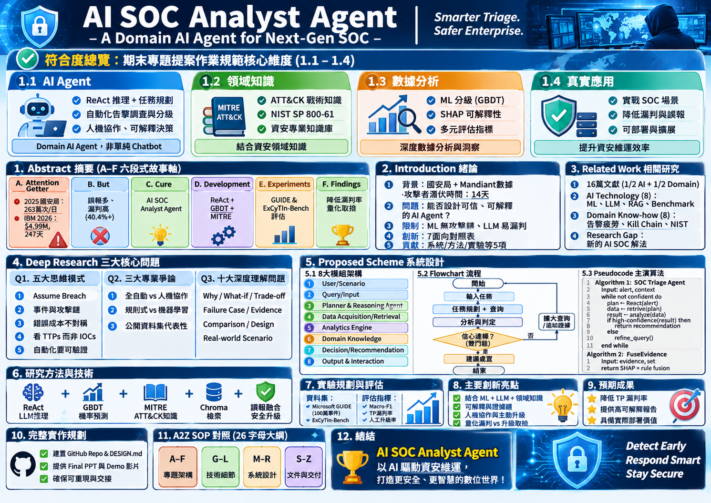

# AI SOC Analyst Agent — 論文領域事實與寫作參考（my_ref）

> **A Domain AI Agent for Next-Gen SOC** — *Smarter Triage. Safer Enterprise.*
> *GBDT + SHAP Triage · MITRE ATT&CK RAG · ReAct LLM Planner · Evidence Fusion & Escalation*



本資料夾是 ICEIB 2027 論文（[`iceib-paper/main.tex`](../iceib-paper/main.tex)）的**唯一領域事實來源**：論文中的數字、架構、演算法與主張都必須能在本檔或其引用的原始文件中找到。原始專題資料完整保存在 [`AIOT-DIC3-ProjectRefactor/`](../AIOT-DIC3-ProjectRefactor/)。

---

## 📁 目錄結構

```text
my_ref/
├── README.md                          # 領域事實摘要（本檔案）：A–F、架構、規則、資料、實驗
├── A2Z outline example.pdf            # 2020 A-Z SOP：論文結構的唯一依據（A–Z、PA–PM）
├── A2Z outline example.md             # A2Z SOP 文字版
└── AI_SOC_Analyst_Agent_overview.png  # 專題總覽資訊圖表（架構、流程、演算法、評估）
```

## 📄 檔案內容導覽

| 檔案 | 類型 | 用途 |
| :--- | :---: | :--- |
| [`README.md`](./README.md) | Markdown | 論文所有領域數字與主張的來源；與 `AIOT-DIC3-ProjectRefactor/docs/proposal.md`、`DESIGN.md` 一致 |
| [`A2Z outline example.pdf`](./A2Z%20outline%20example.pdf) | PDF | 各章節必須涵蓋的 A2Z 字母（Abstract A–F … Conclusion W–Z） |
| [`A2Z outline example.md`](./A2Z%20outline%20example.md) | Markdown | 同上，文字版，方便搜尋與引用 |
| [`AI_SOC_Analyst_Agent_overview.png`](./AI_SOC_Analyst_Agent_overview.png) | PNG | 一頁式總覽：規範符合度、A–F 故事軸、5+3+10 深度研究、①–⑧ 架構、流程圖、A2Z 對照 |

---

## 🎯 A–F 核心論證

1. **A. Attention Getter（攻擊越來越多、偵測越來越慢）**
   * 國安局：2025 年中共對我國關鍵基礎設施網路侵擾**平均每日約 263 萬次**，較 2024 年增加 **6%** [nsb2026]。
   * Mandiant M-Trends 2026：全球潛伏時間中位數由 **11 天增至 14 天** [mtrends2026]。
   * IBM 2026：資料外洩平均成本 **499 萬美元**、從發生到圍堵平均 **247 天**；大量使用 AI 與自動化的組織平均節省 **193 萬美元**、縮短 **65 天** [ibm2026]。
2. **B. But（分級是瓶頸）**
   * 告警疲勞：大量誤報與良性觸發淹沒真實攻擊 [ndichu2026][habibzadeh2025]；多數「誤報」其實是 BP [alahmadi2022]。
   * 五種主流 tool-using LLM 推理策略**都漏判至少 40.4%** 的攻擊告警，常在「查無紀錄」時過早結案 [tsegai2026]；ExCyTIn-Bench 最佳 reward 僅 **0.606** [wu2025excytin]。
   * 自動化程度提高後，分析師降低監控、更依賴自動化（automation complacency）[tilbury2026]。
3. **C. Cure（AI SOC Analyst Agent）**
   * 對事件輸出 **TP / BP / FP** 分級，並以明確規則決定**何時交給人**（`NEEDS_HUMAN_REVIEW`）。
4. **D. Development（證據融合與升級）**
   * ReAct LLM Planner + 規則式證據足夠性 `IsSufficient(E)`（C1–C3）＋ 工具預算 B。
   * GBDT（scikit-learn 直方圖 GBDT，LightGBM 同類）三類機率 + SHAP + k 個相似事件。
   * ATT&CK STIX 2.1 RAG（Chroma）＋ NIST SP 800-61 Rev. 3 / D3FEND playbook ＋ 高風險規則 R1–R5。
   * Evidence Fusion：`s = w_ml·p + w_llm·q`；信心不足、ML 與 LLM 衝突、高風險或證據不足即升級。
5. **E. Experiments（GUIDE + ExCyTIn-Bench）**
   * Microsoft GUIDE（實測 707,108 起事件、5,769 個組織）與 ExCyTIn-Bench；E1–E5 + 消融。
   * 比較：多數類別、Detector 歷史誤報率規則、純 GBDT、純 LLM（無知識庫）。
6. **F. Findings（尚未實驗）**
   * **尚無實驗結果**。論文中所有結果一律標示 `[TBD]`，只能以 `AIOT-DIC3-ProjectRefactor/experiments/results/` 的結果檔填入。

---

## 🧠 5 + 3 + 10 深度研究

**五個核心思維（M1–M5）**

| # | 思維 | 設計決策 |
|---|---|---|
| M1 | Assume Breach：查無紀錄 ≠ 沒有攻擊 | 規則式 `IsSufficient(E)`；用完預算仍不足就升級 |
| M2 | 事件與攻擊鏈脈絡 | 以事件為單位；Tactic 覆蓋與 R1–R5 |
| M3 | 錯誤成本不對稱 | TP 漏判率為首要指標，同時報告升級率；高風險偏向 TP |
| M4 | 看 TTPs 而非 IOCs（Pyramid of Pain） | 以 ATT&CK 技術為知識單位；特徵排除 IP、hash |
| M5 | 自動化要可驗證 | 每個結論附證據鏈與來源；衝突明確標示 |

**三個專業爭論（T1–T3）**：全自動 ↔ 人機協作（以漏判率–升級率曲線量化）；規則 ↔ ML（混合式，以消融量化）；公開資料 ↔ 真實 SOC（依事件／組織／時間切分）。

**十個深度問題**：見 `AIOT-DIC3-ProjectRefactor/docs/project-core.md` §4。

---

## 🏗️ ①–⑧ 系統架構

① Analyst / Alert Queue → ② Input（Incident ID、告警批次、自然語言問題）→ ③ ReAct Planner（LLM + tool use）↔ ④ Retrieval（Evidence Store、唯讀 SQL）／⑤ Analytics（GBDT + SHAP + kNN）／⑥ Domain Knowledge（ATT&CK RAG + R1–R5 + playbook）→ ⑦ Evidence Fusion & Escalation → ⑧ Report（JSON + Markdown）＋ Analyst Feedback。

**`IsSufficient(E)`**：C1 每筆告警都有證據；C2 主要帳號與主機至少有一筆上下文紀錄；C3 空查詢須確認 log 未中斷，否則視為證據不足。

**高風險規則（同一事件內）**

| 規則 | 條件 |
|---|---|
| R1 | Exfiltration 或 Impact，或 Category 為 Ransomware |
| R2 | Credential Access 與 Lateral Movement 同時出現 |
| R3 | Initial Access 與 Execution／Persistence／Privilege Escalation 任一（不要求先後） |
| R4 | T1070 Indicator Removal |
| R5 | 涵蓋 ≥ 4 個不同戰術（門檻在驗證集確認） |

**升級條件**：`conf < τ` 或 `conflict` 或 `high_risk` 或 `not IsSufficient(E)` → `NEEDS_HUMAN_REVIEW`。高風險且 `p_TP ≥ τ_safety` 時標籤提升為 TP。LLM 信心「低／中／高」對應 c = 0.5／0.7／0.9。

**範例（示意，非實驗結果）**：p = (0.46, 0.45, 0.09)、q = (0.70, 0.15, 0.15)、w = 0.5 → s = (0.58, 0.30, 0.12)；信心低、觸發 R2、缺登入紀錄 → 升級。

---

## 📊 資料與實驗

**GUIDE_Train.csv 實測**（`experiments/e0_profile_guide.py`）：9,516,837 列、**707,108** 起事件（`OrgId` + `IncidentId`）、**5,769** 個組織；TP **20.6%**、BP **49.0%**、FP **30.4%**；432 種 ATT&CK 技術；`MitreTechniques` 只有 **42.5%** 的列有值；處置標籤 **99.4%** 缺值；`AlertTitle`、`DetectorId` 與所有實體欄位為匿名化 ID。

**GUIDE 論文規模**：約 1,300 萬筆證據、160 萬筆告警、100 萬起事件、6.1k 個組織、441 種技術。

**ExCyTIn-Bench**：57 張 log 表、8 條攻擊鏈、7,542 題。

| 實驗 | 內容 | 指標 |
|---|---|---|
| E1 | 分級 vs. 四個 baseline | Macro-F1、P/R、TP 漏判率、人工升級率 |
| E2 | ATT&CK 對應：LLM vs. LLM + RAG | Technique／Tactic P、R |
| E3 | ExCyTIn 調查推理 | Benchmark reward |
| E4 | 報告品質（50 個事件） | 評分表 |
| E5 | 成本 | token、延遲、工具呼叫數 |
| Ablation | 移除 ⑤、⑥ 或升級規則 | 同 E1 |

**誠實原則**：未執行的實驗一律標 `[TBD]`；不得填入預期或推測的數字。LLM 實驗花費上限約 550 美元。

---

## 📚 文獻

論文共 24 篇參考文獻（AI Technology 與 Domain Know-how 各半，外加產業報告與經典文獻），完整清單與文獻彙整表見 `AIOT-DIC3-ProjectRefactor/docs/proposal.md` §3.3、§6；論文內的 IEEE 格式條目見 `iceib-paper/main.tex` 的 `thebibliography`。
